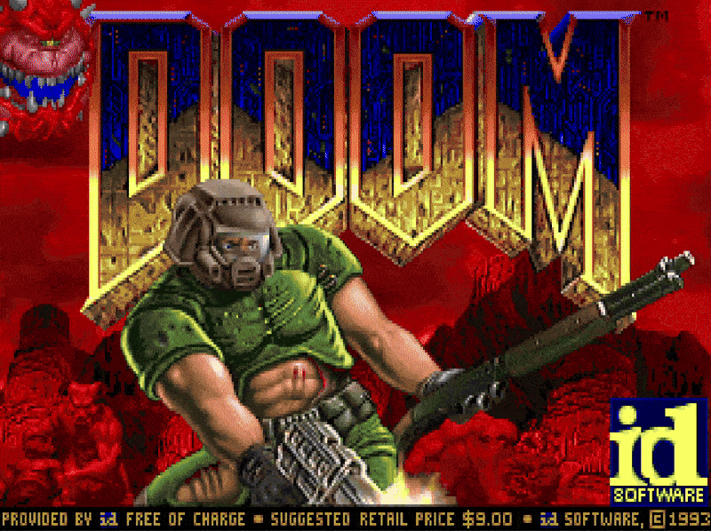
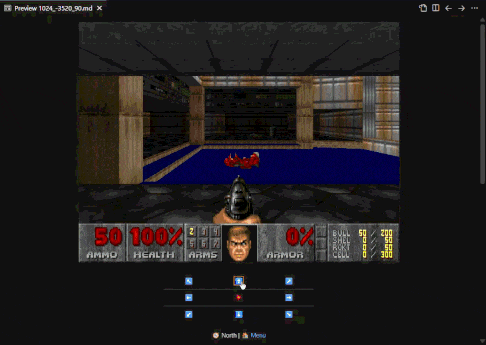

<h1 align="center">iDOOM: Running DOOM from a GitHub Readme</h1>

<p align="center">
<a href="menu/episode_1.md">

</a>
<br>
<sub><strong>Yes, this is literally the game. You can click it to start playing.</strong></sub>
</p>

<p align="center">

<a href="LICENSE"></a>
</p>

---

## What Is This?

**iDOOM** is Doom's E1M1 level running entirely inside GitHub's markdown viewer. Without using any javascript or a backend server, it's just **4,340 pre-rendered screenshots** linked together with hyperlinks.

Every position × every angle = a unique markdown file. Click a direction, load a new file. That's the whole "engine."

---

## Gameplay

Here's some gameplay captured locally

<p align="center">

</p>


## Repo Structure

```
iDOOM/
├── assets/              # 4,340 WebP screenshots (doom_x_y_angle.webp)
├── game/                # 4,340 navigation markdown files
├── menu/                # Episode & difficulty selection screens
├── static/              # Banner GIF, map image, menu assets
├── linker.py            # Generates the markdown graph from map_data
├── gridmapper.py        # VizDoom capture script
├── omgi_mapper.py       # WAD parser using Omgifol
├── map_data.json        # Valid (x, y) coordinates for E1M1
└── README.md            # You are here
```

---

## How It Works (TL;DR)

1. **Parse the WAD** — `omgi_mapper.py` uses [Omgifol](https://github.com/devinacker/omgifol) to extract E1M1 geometry
2. **Generate the grid** — Point-in-Polygon filtering on a 64-unit grid → 1,085 valid spots  
3. **Capture screenshots** — `gridmapper.py` teleports a VizDoom agent to each spot, 4 angles each
4. **Link it all** — `linker.py` builds the navigation graph as interlinked `.md` files

## License

MIT - feel free to tweak around and play with the code
Feel free to raise issues and PRs too

