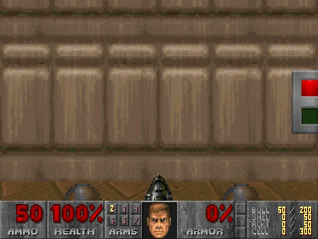

<table align="center">
<tr>
<td align="center" width="80"><a href="3072_-4800_0.md"><kbd>&nbsp;↖️&nbsp;</kbd></a></td>
<td align="center" width="80"><a href="3072_-4864_0.md"><kbd>&nbsp;⬆️&nbsp;</kbd></a></td>
<td align="center" width="80"><kbd>&nbsp;↗️&nbsp;</kbd></td>
</tr>
<tr>
<td align="center" width="80"><a href="3008_-4864_90.md"><kbd>&nbsp;⬅️&nbsp;</kbd></a></td>
<td align="center" width="80"><a href="end_game.md" title="Flip Exit Switch"><kbd>&nbsp;🏁 EXIT&nbsp;</kbd></a></td>
<td align="center" width="80"><a href="3008_-4864_270.md"><kbd>&nbsp;➡️&nbsp;</kbd></a></td>
</tr>
<tr>
<td align="center" width="80"><a href="2944_-4800_0.md"><kbd>&nbsp;↙️&nbsp;</kbd></a></td>
<td align="center" width="80"><a href="2944_-4864_0.md"><kbd>&nbsp;⬇️&nbsp;</kbd></a></td>
<td align="center" width="80"><kbd>&nbsp;↘️&nbsp;</kbd></td>
</tr>
</table>

🧭 <b>Facing</b>: East &nbsp;|&nbsp; 📍 <b>Area</b>: Exit Chamber &nbsp;|&nbsp; <a href="../README.md">🏠 Main Menu</a>

